<p align="center">
  <a href="https://agentflowharness.com"></a>
</p>

<h1 align="center">Agent Flow Harness</h1>

<p align="center">
  <b>Your agents. Your machine. Your flow.</b><br />
  A free, open-source coding agent for Windows, Mac and your terminal. It plans, delegates and writes code with the models you choose,<br />
  and you can watch every line as it happens.
</p>

<p align="center">
  <a href="https://github.com/Lucifer-xD/agent-flow-harness/releases/latest"></a>
  <a href="https://agentflowharness.com/download"></a>
  <a href="https://agentflowharness.com/download"></a>
  <a href="https://agentflowharness.com/download"></a>
  <a href="https://github.com/Lucifer-xD/agent-flow-harness/actions/workflows/tests.yml"></a>
  <a href="LICENSE"></a>
</p>

<p align="center">
  <a href="https://agentflowharness.com/download"><b>Download</b></a> ·
  <a href="https://agentflowharness.com">Website</a> ·
  <a href="https://agentflowharness.com/docs">Docs</a> ·
  <a href="https://agentflowharness.com/models">Models</a> ·
  <a href="https://agentflowharness.com/api">API</a> ·
  <a href="CHANGELOG.md">Changelog</a> ·
  <a href="https://agentflowharness.com/chat">AFH Chat</a>
</p>

<p align="center">
  <picture>
    <source media="(prefers-color-scheme: light)" srcset="docs/screenshots/hero-light.webp" />
    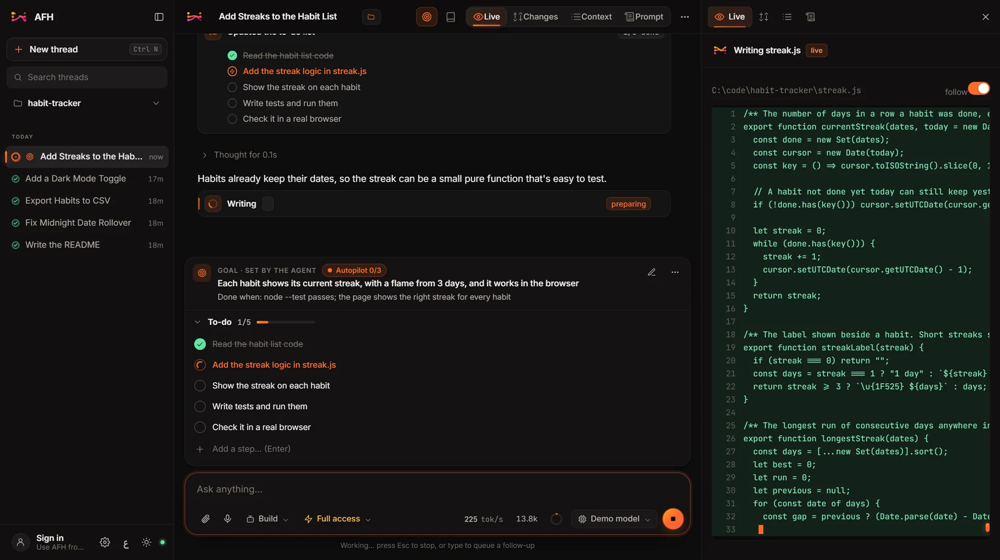
  </picture>
</p>

## Why AFH

- **It finishes the job.** It plans the work as a to-do list you can edit, does it, runs the tests, checks the result in a real browser, and tells you plainly what's done or what's in the way.
- **You see everything.** Code streams into the Live pane as it's written. Every thought, tool call, command and diff is in the thread, and the Context view shows exactly what the model sees.
- **Any model, mixed freely.** 200+ providers, local models, or sign in with a plan you already pay for: ChatGPT, GitHub Copilot, Grok, Google Antigravity, MiniMax, Poe or OpenRouter. Lead with a strong model and hand work to fast, cheap ones.
- **You stay in control.** Choose Ask first, Full access or Read only. Stop is instant. Undo rewinds the thread *and the files on disk*.
- **It's yours.** Everything runs and is stored on your PC. No account needed, and the app sends no telemetry. The engine is written from scratch in this repo, in plain Python.

## Contents

- [Get it](#get-it)
- [A tour](#a-tour)
- [What it can do](#what-it-can-do)
- [On your phone and on the web](#on-your-phone-and-on-the-web)
- [Models and providers](#models-and-providers)
- [Everyday use](#everyday-use)
- [Build on it: API and SDKs](#build-on-it-api-and-sdks)
- [Private by design](#private-by-design)
- [Run it from source](#run-it-from-source)
- [Contributing](#contributing)
- [License](#license)

## Get it

| | |
|---|---|
| **Windows** | Download the installer from **[agentflowharness.com/download](https://agentflowharness.com/download)** or [GitHub Releases](https://github.com/Lucifer-xD/agent-flow-harness/releases/latest) and run it. The app isn't code-signed yet, so Windows may say it protected your PC: choose **More info → Run anyway**. AFH updates itself after that. |
| **Mac** | Download the [Apple Silicon](https://github.com/Lucifer-xD/agent-flow-harness/releases/latest/download/AFH-mac-arm64.dmg) or [Intel](https://github.com/Lucifer-xD/agent-flow-harness/releases/latest/download/AFH-mac-x64.dmg) DMG and drag AFH to Applications. It isn't signed by Apple yet, so the first time, go to *System Settings → Privacy & Security* and choose **Open Anyway**. |
| **Terminal** | One command on Windows, Mac or Linux, below. No desktop app needed. |
| **Android** | Download the APK from the [download page](https://agentflowharness.com/download) and open it. Allow installs from your browser when asked. |
| **iPhone** | Download the IPA from the [download page](https://agentflowharness.com/download) and install it with [Sideloadly](https://sideloadly.io) or [AltStore](https://altstore.io). |
| **Web** | Open **[agentflowharness.com/chat](https://agentflowharness.com/chat)** and sign in. Nothing to install. |

```powershell
# Windows
irm https://agentflowharness.com/install.ps1 | iex
```

```bash
# macOS and Linux
curl -fsSL https://agentflowharness.com/install.sh | bash
```

Then type `afh` in a project folder. It's the same AFH, full screen: threads, models, approvals and every setting. See the [terminal guide](docs/cli.md).

<p align="center">
  <picture>
    <source media="(prefers-color-scheme: light)" srcset="docs/screenshots/tui-light.png" />
    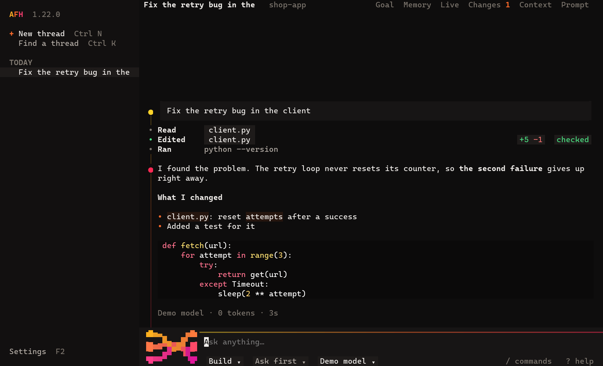
  </picture>
</p>

**First run:** AFH opens *Models & providers*. Sign in with a plan, paste an API key, or pick a local model (Ollama, LM Studio and friends need no key). Then open a project folder and ask for something.

## A tour

<table>
<tr>
<td width="50%">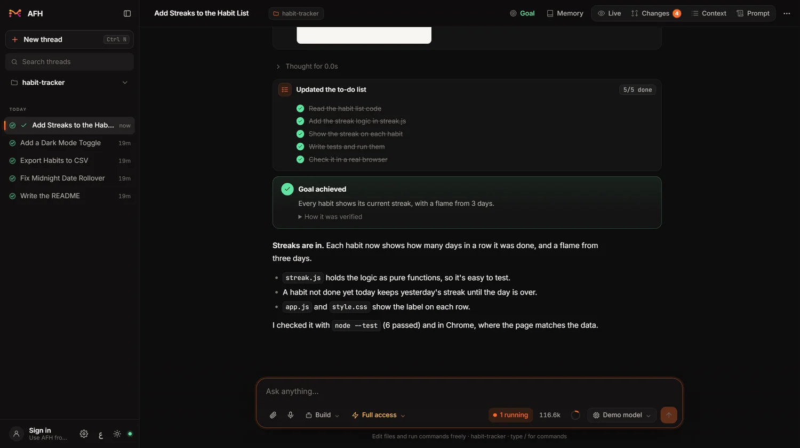<br /><b>It says how it knows it's done.</b> The to-do list is ticked off, the goal is marked achieved, and the reply says how the work was checked.</td>
<td width="50%">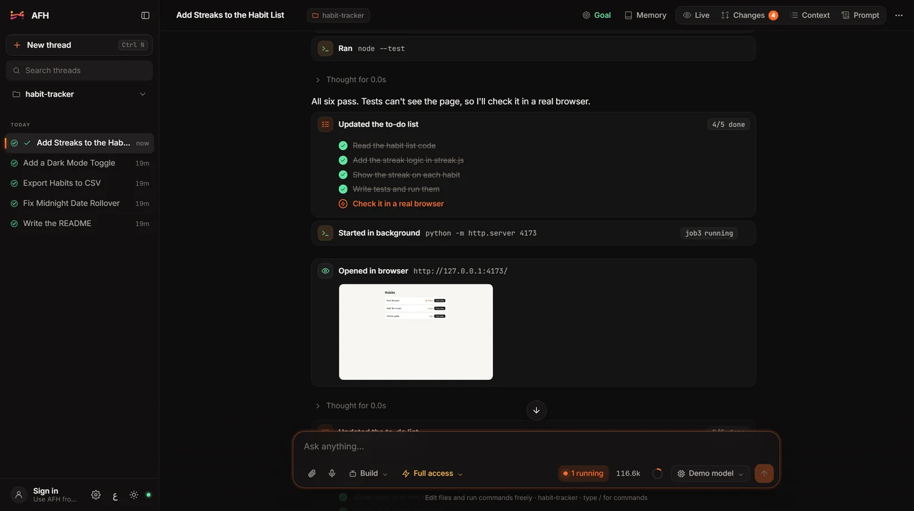<br /><b>It looks at its own work.</b> The agent opens what it built in a real browser, reads the console and sees the screenshot, then fixes what's wrong.</td>
</tr>
<tr>
<td width="50%">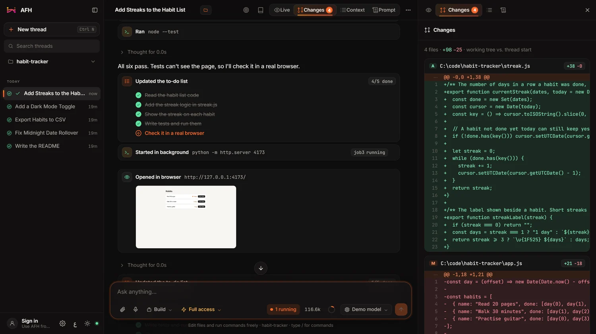<br /><b>Every change, reviewable.</b> The Workbench lists each file the thread touched, with diffs. Undo to any message rewinds the files too.</td>
<td width="50%">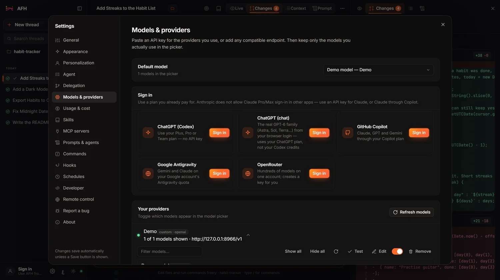<br /><b>Bring any model.</b> Sign in with a plan you already pay for, paste a key, or point it at any compatible endpoint.</td>
</tr>
<tr>
<td width="50%">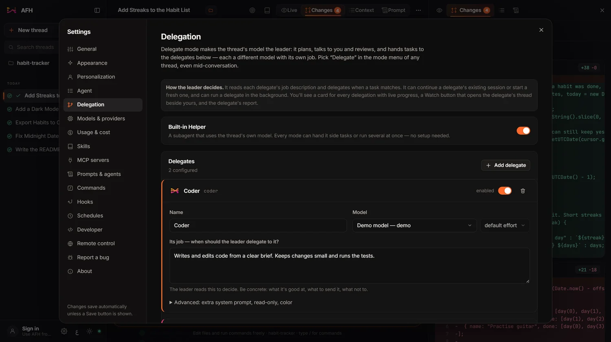<br /><b>Models working together.</b> In Delegate mode one model leads and hands tasks to delegates, each with its own model and job.</td>
<td width="50%">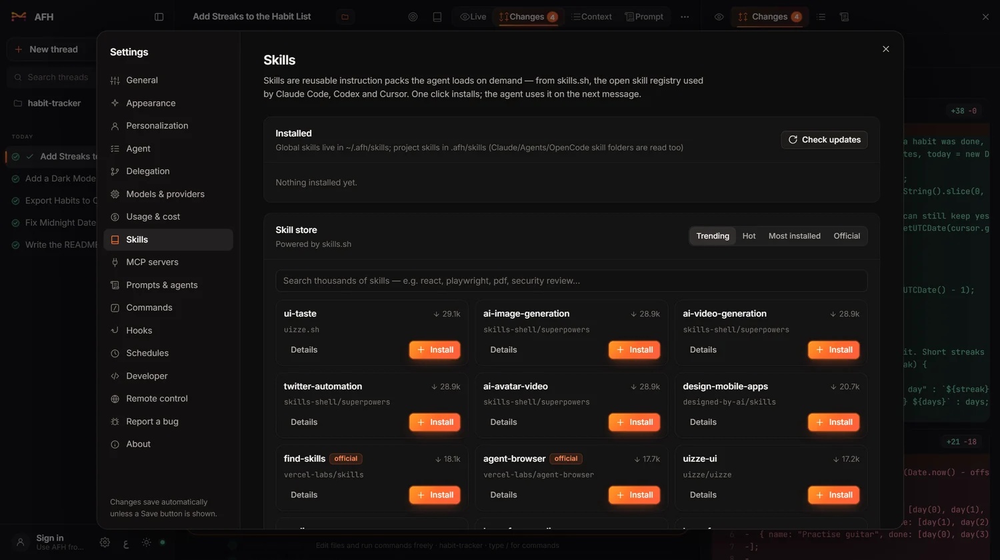<br /><b>Extend it in one click.</b> Install skills from the skills.sh store, add MCP servers, or just ask: the agent can install new abilities itself.</td>
</tr>
<tr>
<td width="50%">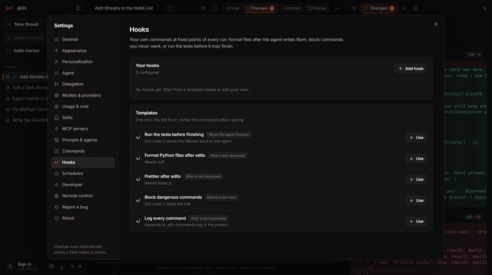<br /><b>Hooks.</b> Your own commands before or after any tool, or when the agent stops: format on save, block risky commands, "the tests must pass".</td>
<td width="50%">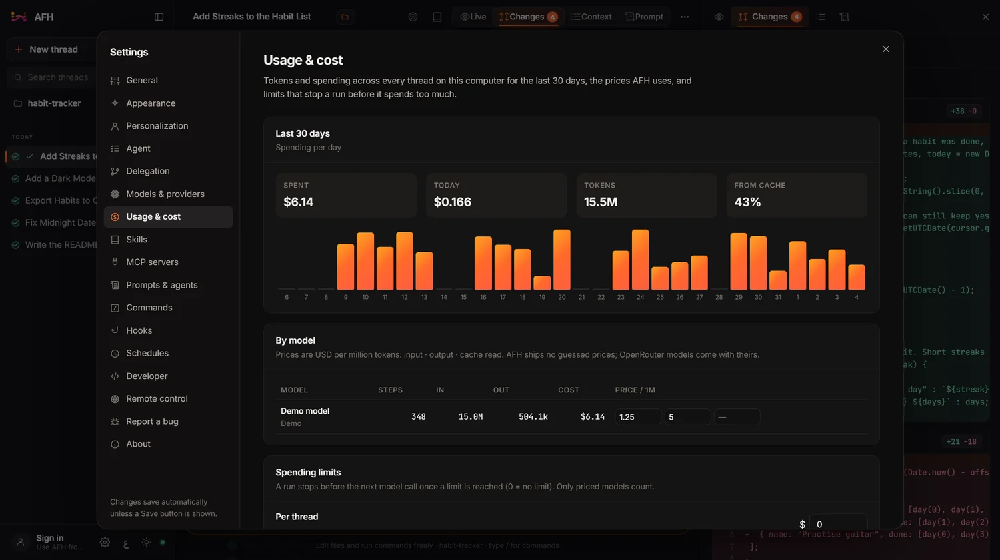<br /><b>Know what it costs.</b> Tokens, cache hits and cost per model, 30 days of usage, your own prices and spending limits.</td>
</tr>
</table>

## What it can do

**Plans and finishes**
- **A to-do list you can touch:** every step shows above the message box, and your edits reach the agent on its next turn.
- **Goals with autopilot:** ask for a goal, or type `/goal`, and the agent works until it's met or reports *blocked* with what it needs.
- **It asks instead of guessing:** when a choice is really yours, it pauses with multiple-choice questions.
- **Design first:** before building a new app or site, it shows 2 to 4 design options as live screens in phone, tablet or desktop frames, and you pick one.
- **Project memory:** how to run the project, the gotcha that cost an hour, the way you like things done. Say "remember…", type `/remember`, or edit it under **Memory**.
- **Picks up after a restart:** close the app mid-run, or lose power, and interrupted runs resume by themselves.

**Splits the work**
- **Four modes:** *Build* does the work, *Plan* investigates without changing anything, *Delegate* leads and hands out tasks, and *Red Team* audits your own project. Or create your own agents.
- **Helpers in parallel:** the built-in Helper and your own subagents run side by side, and you can watch any of them live.
- **Mix models:** lead with your strongest model, hand tests to a fast one and styles to another, across providers.
- **Git worktrees:** give a thread or a delegate its own branch and folder, then merge it back with one click.
- **Model races:** give one task to several models at once, each in its own worktree. Your tests score them, and you merge the winner.
- **GitHub agent:** write `/afh` and a task on an issue or pull request. AFH does the work on your computer and opens a draft pull request. Only people you allow can start it.
- **AFH in your terminal:** everything, full screen, with one command to install. Or run one task from a script or CI with `afh run`. See the [terminal guide](docs/cli.md).

**Works beyond the code**
- **A built-in browser:** a tabbed browser in the side panel with DevTools. Watch the agent click and type, or take over any time.
- **Computer use:** for work with no file, command or web route, the agent can use desktop apps. It asks before it touches an app, and a frame around the screen shows while it's working.
- **Red Team mode:** finds the weaknesses an attacker could use in your own project and reports them. It stays in scope and never changes your code.
- **Errors caught after edits:** Python, JSON, TOML, JavaScript, TypeScript (your project's `tsc`), Go, PHP, Ruby and your own linters. Problems go straight back to the model.
- **Images and voice:** paste or drop screenshots and files, or press the mic and speak (with a Groq or OpenAI speech key).

**You watch it work**
- **One Workbench:** Live, Changes, Browser, Context, Prompt and Agents as tabs on the right.
- **Live files and commands:** code appears as it's generated, and command output scrolls in as it arrives.
- **Every step on a timeline:** thinking time, each tool call, tokens per second and how long each reply took.

**You stay in control**
- **Approval modes:** *Ask first* shows every edit and command for approval, with diffs. *Full access* and *Read only* are one click away. Reading `.env` files always asks.
- **Stop is instant:** the run, the model call and any running command stop the moment you press Stop or Esc.
- **Rewind anything:** *Undo to here* rewinds the thread and the files on disk to just before a message. Or fork the thread from any point.
- **Nothing hidden:** *Context* shows and lets you edit everything the model sees, and *Prompt* shows the exact system prompt.
- **Cost you can see:** a usage meter for your plan's limits, tokens and cost per thread, and budgets that stop a run. Prompt caching is on by default for Anthropic.

**Built for long sessions**
- **Endless threads:** when a conversation fills the model's context, older parts are summarised in place, and you can still read every message. Or type `/compact`.
- **Background jobs:** dev servers, watchers and long builds run while the agent keeps working (`/jobs`).
- **Schedules:** run a prompt every few minutes, hourly, daily, on weekdays or weekly. Each run is a new thread you can read.
- **Bring your threads:** import from OpenCode or Zadloop, and export any thread as JSON or Markdown.

**Make it yours**
- **Four interfaces:** Studio, Focus (just the conversation), Compact (built for long working sessions) or Canvas (the thread on its own sheet). Each is laid out differently, with its own parts, motion and themes.
- **58 themes** with your own accent colour, or build your own.
- **English and Arabic**, with a full right-to-left layout, switchable live.
- **Slash commands:** `/goal` `/todo` `/memory` `/remember` `/compact` `/jobs` `/new` `/cost` `/review` `/fix-tests` `/explain` `/commit`, plus your own as Markdown files (`.claude/commands` works too).
- **MCP servers and skills:** local or remote MCP servers, and skills from `~/.afh/skills` or the project. Skills made for other agents work as they are.

<p align="center">
  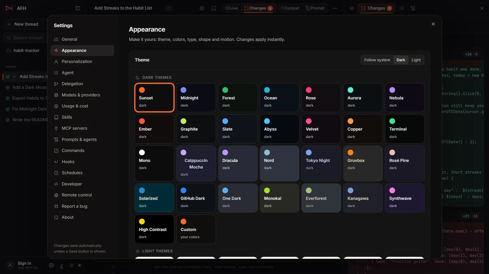
</p>

## On your phone and on the web

<p align="center">
  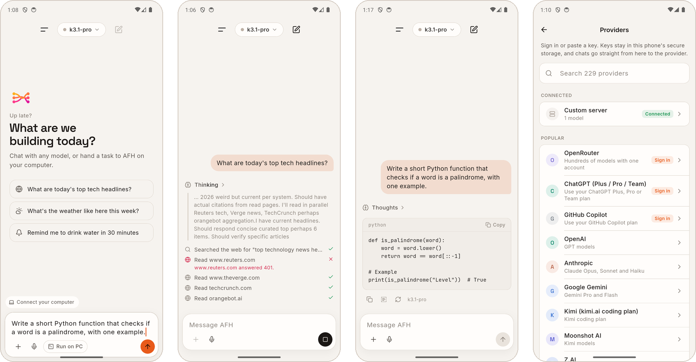
</p>

The **AFH app for Android and iPhone** does three things:

- **Chat with any model, straight from your phone.** Keys stay in the phone's secure storage and chats go straight to the provider. It works with your computer off and without an account.
- **An assistant that can use your phone.** It searches the web, checks the weather, sets reminders, adds calendar events, finds contacts, and drafts calls, texts and emails for you to send. Each step shows in the reply.
- **Your computers, from anywhere.** Sign in to see which computers are online, follow their threads live, approve actions with a tap, send the next task or stop a run. Nothing to open on your router.

**[AFH Chat](https://agentflowharness.com/chat)** is the same chat in your browser, with your chats kept in your browser.

The optional **AFH account** is only for reaching your computers and the web chat. AFH itself needs none, and the server never stores your threads, files or keys.

## Models and providers

- **200+ providers** from the open [models.dev](https://models.dev) catalog: OpenAI, Anthropic, Google Gemini, Kimi, Z.AI, DeepSeek, Groq, OpenRouter, Mistral, xAI, Together, Fireworks, Cerebras, Perplexity and many more. Context sizes, effort levels, inputs and prices come from the catalog, and you can correct them by hand.
- **Sign in instead of pasting a key:**
  - **ChatGPT (Codex):** your Plus, Pro or Team plan.
  - **ChatGPT (chat):** the chat models on your ChatGPT plan, using your browser login.
  - **GitHub Copilot:** Claude, GPT and Gemini through your Copilot plan.
  - **Grok (xAI):** your SuperGrok or X Premium+ plan, with a code you approve on x.ai. AFH talks to xAI as the Grok CLI, the only app the plan pays for, so xAI could stop it working or act on your account.
  - **Google Antigravity:** Gemini and Claude on your Google account's quota.
  - **OpenRouter:** one account for hundreds of models.
  - **MiniMax Token Plan:** on minimax.io or minimax.cn.
  - **Poe** and **DigitalOcean:** sign in and AFH creates the key for you.
  - **ChatGPT with a code:** the same ChatGPT plan when there's no browser, such as over SSH.
- **Local models with no key:** Ollama, LM Studio, vLLM, llama.cpp and Jan. AFH finds the ones running on your computer.
- **Any compatible endpoint:** anything that speaks the OpenAI, Anthropic or Gemini API.

See the full list at [agentflowharness.com/models](https://agentflowharness.com/models).

## Everyday use

| Where | What |
|---|---|
| **Mode** (message box) | *Build*, *Plan*, *Delegate*, *Red Team*, or your own agents. |
| **Approval** | *Ask first*, *Full access* or *Read only*, per thread, changeable any time. |
| **Model** | Model and effort level for this thread. |
| **Goal** and **Memory** | What done looks like, autopilot and the to-do list; what the agent knows about the project. |
| **Worktree** (new thread, git projects) | The thread works on its own branch, and the branch chip merges it back. |
| **Workbench** | Live, Changes, Browser, Context, Prompt and Agents. |
| **Type `/`** | Commands. |
| **Hover a message of yours** | **Undo to here** rewinds the thread and your files. |

| Key | Does |
|---|---|
| `Enter` / `Shift+Enter` | Send / new line |
| `Esc` | Stop |
| `Ctrl+N` | New thread |
| `Ctrl+K` | Search threads |
| `Ctrl+P` | Command palette |
| `Ctrl+B` | Hide or show the sidebar |
| `Ctrl+Shift+B` | Built-in browser |
| `Ctrl+,` | Settings |

## Build on it: API and SDKs

Everything the app does is a local REST API: create threads, send messages, stream every token and tool call, read replies and diffs, set goals and approve actions. Create a key in **Settings → Developer**.

```python
from afh_sdk import AFH            # sdk/python: one file, standard library only

afh = AFH()                        # finds the running app; key from $AFH_API_KEY
result = afh.run("Add a /health endpoint and a test for it", directory=r"C:\code\api")
print(result["reply"])

for event in afh.events():         # live events from every thread
    print(event["type"])
```

The JavaScript SDK is [`sdk/js/afh.mjs`](sdk/js/afh.mjs). Full reference: [agentflowharness.com/api](https://agentflowharness.com/api).

## Private by design

- Threads, settings, keys and undo history live in `%USERPROFILE%\.afh` on your PC, or in your phone's secure storage.
- Your code goes only to the model providers you choose.
- If you connect ChatGPT (chat), AFH reads your `chatgpt.com` login from your browser on your own computer, only when you ask it to. You can paste the session instead.
- With computer use, screenshots of the apps you allow go to the model you chose.
- The only other calls are the update check, the model catalog refresh, and the skill store, web search or voice if you use them.
- The website's server log counts downloads, visits and apps in use (from update checks and phone sign-ins) as daily totals. Your code and chats are never part of that.

Found a security problem? Please [report it privately](SECURITY.md).

## Run it from source

You need Python 3.12 and Node 20 or newer. The commands below are for Windows. On a Mac, use `.venv/bin/python` and `scripts/build-backend.sh`.

```powershell
git clone https://github.com/Lucifer-xD/agent-flow-harness.git
cd agent-flow-harness
python -m venv .venv
.venv\Scripts\pip install -r requirements.txt -r requirements-dev.txt

.venv\Scripts\python run.py --browser        # the backend, with the UI in your browser
.venv\Scripts\python -m pytest tests -q      # the tests
```

Or double-click `AFH.bat`, which sets everything up on first run. For the Electron window, the installer and the phone app, see [desktop/README-dev.md](desktop/README-dev.md) and [app/README.md](app/README.md).

| Folder | What's in it |
|---|---|
| [`afh/`](afh) | The Python backend (FastAPI + SSE), loopback only and token-protected |
| [`afh/engine/`](afh/engine) | The AFH Engine: the agent loop, tools, providers, sessions, permissions and more |
| [`web/`](web) | The desktop UI: plain HTML, CSS and JavaScript with no build step |
| [`desktop/`](desktop) | The Electron shell and the Windows and Mac installers |
| [`app/`](app) | The phone app (Flutter) |
| [`relay/`](relay) | The AFH account server: sign-in, computers and the relay |
| [`website/`](website) | agentflowharness.com, including AFH Chat |
| [`sdk/`](sdk) | The Python and JavaScript SDKs |
| [`scripts/`](scripts), [`deploy/`](deploy) | Build, install and deploy scripts |
| [`tests/`](tests) | The pytest suite |

[docs/architecture.md](docs/architecture.md) explains how it all fits together.

## Contributing

Bug reports, ideas and pull requests are welcome. Start with [CONTRIBUTING.md](CONTRIBUTING.md), and please follow the [Code of Conduct](CODE_OF_CONDUCT.md).

## License

[MIT](LICENSE). AFH includes or builds on the [marked](https://github.com/markedjs/marked) (MIT), DOMPurify (Apache-2.0/MPL-2.0), highlight.js (BSD-3-Clause), Electron (MIT), FastAPI (MIT), httpx (BSD-3-Clause), MCP Python SDK (MIT) and Flutter (BSD-3-Clause) projects. The Inter and JetBrains Mono fonts are under the SIL Open Font License.
