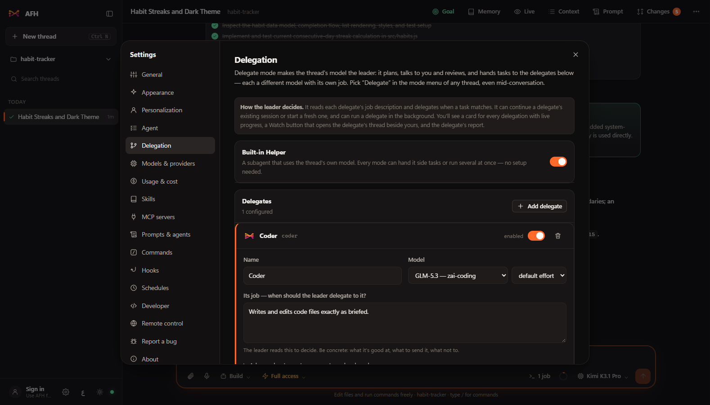
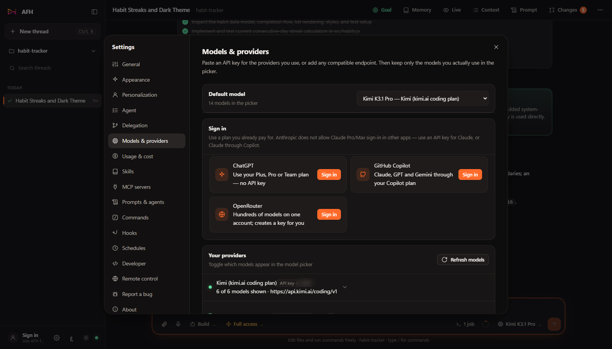
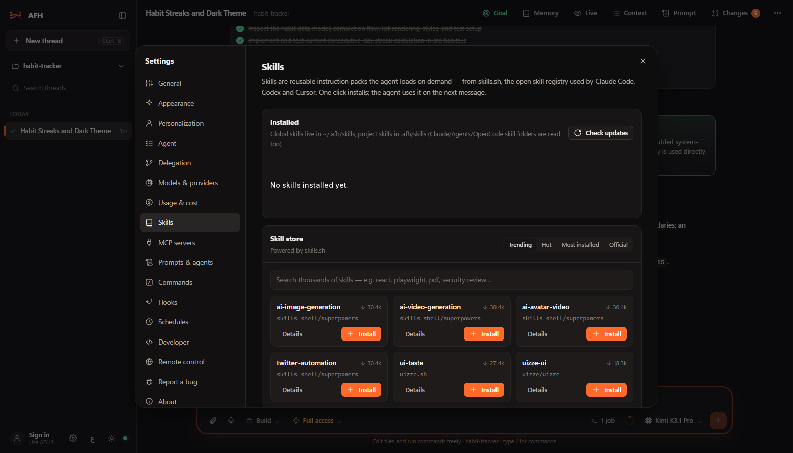

<p align="center">
  
</p>

<h1 align="center">Agent Flow Harness</h1>

<p align="center">
  <b>An open-source desktop coding agent that works with any AI model — and lets models work together.</b><br/>
  Pick a model, point it at a folder, and it reads, edits and runs code there with your approval.<br/>
  Let one model lead and delegate to others. Control it from your phone. Everything runs on your own computer.
</p>

<p align="center">
  
  
  
  
</p>

<p align="center">
  
</p>

---

## What it does

| | |
|---|---|
| **Any model** | Context windows, effort levels, image/video/audio/PDF input and prices come from the open models.dev catalog (correctable by hand). Paste an API key for OpenAI, Anthropic, Gemini, Kimi, Z.AI, DeepSeek, Groq, OpenRouter, Mistral, xAI, Together, Fireworks, Cerebras or Perplexity, or point AFH at any OpenAI-, Anthropic- or Gemini-compatible endpoint. Local models too (Ollama, LM Studio, vLLM, llama.cpp, Jan) with no key — AFH finds the ones running on your computer. Hide the models you don't use so the picker stays short. |
| **Delegate mode** | One model leads: it plans, talks to you and reviews. It hands tasks to **delegates** — other models with jobs you describe ("writes code", "reviews diffs", "writes tests"). Every delegation shows live progress, needs-your-approval prompts, a **Watch** button that opens the delegate's thread beside yours, and its report. Switch modes any time, even mid-conversation. |
| **Goals & to-do list** | The agent sets a **goal** by itself for any multi-step task (or you set one: "all tests pass and the login page works") and plans it as a live **to-do list** you can see and edit, works through it, checks the result and reports the goal **achieved** — or **blocked** if it needs you. With **autopilot** it keeps going on its own instead of stopping to ask. |
| **It checks its own work** | After every edit AFH checks the changed files (Python, JSON, TOML, JavaScript, TypeScript with your project's `tsc`, Go, PHP, Ruby, plus your own linters) and hands any errors straight back to the model, so it fixes them before you see them. |
| **Runs your app** | Servers, watchers and long builds run as **background jobs**: the agent starts your dev server, waits for "ready", tests against it, and stops it. You see every job and its output from the composer. |
| **Many agents at once** | Every mode has a built-in **Helper** subagent (your own model), plus the delegates you configure. Independent reads, searches and **subagents run in parallel**, and the top bar shows how many are working — with what each was asked, what it replied, and **Watch**. Each thread or delegate can work in its own **git worktree** (own branch and folder) so parallel agents never collide; merge the branch back with one click. |
| **Hooks & commands** | **Hooks** run your own commands before or after tools and when the agent finishes (format on save, block risky commands, "the tests must pass before you stop"). **Slash commands** (`/review`, `/fix-tests`, `/goal`, `/compact`, your own, or `.claude/commands/*.md` files) are one keystroke away. |
| **Knows what it costs** | Tokens, prompt-cache hits and **cost** per step and per thread, a 30-day **Usage & cost** page, your own prices per model, and **spending limits** per thread or per day. Prompt caching on Anthropic and smarter context trimming keep long threads cheap. |
| **Never loses work** | If AFH closes in the middle of a run — an update, a crash — it picks that thread up again by itself when it reopens. |
| **You stay in control** | *Ask first* mode shows every file change (with a diff) and every command before it runs. *Full access* and *Read only* are one click away. **Undo** rewinds the thread **and the files on disk** to before any message. |
| **See everything** | **Context** shows exactly what the model sees — your messages, its replies, tool inputs and outputs, system notices — and lets you edit or delete any of it. **Prompt** shows the exact system prompt the model receives, which you can copy, change or replace. |
| **Extend it** | A **Skills store** (skills.sh) installs skills with one click. Add **MCP servers** (Chrome, Playwright, GitHub, filesystem…) from Settings. |
| **Your own engine** | No third-party harness underneath: the agent loop, tools (read, write, edit, patch, glob, grep, list, shell, jobs, todo, goal, webfetch, websearch), permissions, undo snapshots, delegation, worktrees, hooks, error checks, compaction and MCP client are all in this repo, in plain Python. Tool calls stream live, so you watch files being written line by line. |
| **Take it anywhere** | **Remote control**: open the same app on your phone or another computer over Wi-Fi (password-protected), optionally from outside your network through a free Cloudflare tunnel. **Export** any thread as a file and **import** it on another PC; import your old **Zadloop / DeepSeek Harness** sessions. |
| **Feels good** | Smooth streaming, eased scrolling, a logo that flows while a model is thinking, 25 dark and light themes with a one-click dark/light switch, your accent color, a **command palette** (Ctrl+P), and an **Arabic interface** with right-to-left layout (the conversation follows each paragraph's own language). A **message rail** on the left jumps to any message of yours; drag the chat's edge to make it wider. |

<p align="center">
  
  
</p>
<p align="center">
  
  
</p>

## Install (no programming needed)

1. **Download AFH**: open the [Releases](../../releases) page and download `AFH-Setup-1.6.0.exe`.
2. **Run the installer.** Windows may show a blue *"Windows protected your PC"* screen because the app isn't code-signed yet — click **More info → Run anyway**. Pick a folder, finish, and AFH opens.
3. **Connect a model**: on first launch AFH opens *Models & providers*. Pick a provider and paste its API key (local servers like Ollama need none). If you used OpenCode before, one click imports its keys, MCP servers and threads. Then set your **Default model**.
4. **Open a folder** (the project you want to work on) and ask for something.

That's it. Nothing else to install. Your settings, keys and threads live in `C:\Users\<you>\.afh` and never leave your PC except to the model providers you chose.

### Using it from your phone

Settings → **Remote control** → set a password → turn it on. Scan the QR code (or type the address) on a phone connected to the same Wi-Fi. For access from anywhere, turn on the Cloudflare tunnel (requires [cloudflared](https://developers.cloudflare.com/cloudflare-one/connections/connect-apps/install-and-setup/installation/) installed on the PC). Windows Firewall will ask once to allow Python on private networks — allow it.

## Everyday use

| Where | What |
|---|---|
| **Mode pill** (bottom of the composer) | *Build* does the work itself. *Plan* only plans. *Delegate* leads and delegates to your delegates. Custom agents you create appear here too. |
| **Approval pill** | *Ask first* / *Full access* / *Read only*. Per thread, changeable any time. |
| **Model pill** | Model and effort level for this thread. |
| **Goal** (top right, or the Goal pill on a new thread) | Set what done looks like; the dock above the composer shows the goal, autopilot, and the live to-do list. |
| **Worktree pill** (new thread, git projects) | The thread works in its own copy of the repo on its own branch; the branch chip in the top bar merges it back. |
| **Type `/`** | Commands: `/goal`, `/compact`, `/review`, `/fix-tests`, `/explain`, `/commit`, your own. |
| **Jobs chip** (composer) | Background jobs the agent started: live output, stop. |
| **Context** (top right) | See and edit everything the model sees. |
| **Prompt** | The exact system prompt, instructions, skills and permissions in effect. |
| **Changes** | Every file the thread changed, with diffs. |
| **⋯ menu** | Rename, fork, edit context, export, copy as Markdown, archive, delete. |
| **Hover a message of yours** | **Undo to here** — rewinds the thread and your files. |
| **Project menu** (sidebar) | Open folders, switch projects, **Import thread** (from an export file, OpenCode or Zadloop). |

Keyboard: `Enter` send · `Shift+Enter` new line · `/` commands · `Ctrl+P` command palette · `Esc` stop · `Ctrl+N` new thread · `Ctrl+K` search · `Ctrl+B` sidebar · `Ctrl+,` settings.

## Goals and the to-do list

1. Usually you do nothing: for multi-step work the agent sets the goal itself (Settings → Agent can turn that off). To set one yourself, click **Goal** (top right) — or on a new thread, the **Goal** pill next to the mode pills — or type `/goal <what done looks like>`.
2. Describe the goal and, optionally, **Done when** (how to check it: "`npm test` passes and the page loads"). Leave **Autopilot** on to let the agent keep working until it is done.
3. Click **Start now**. The agent writes its plan as a to-do list above the composer and ticks items off as it works. You can tick, add, edit (double-click) or remove items yourself — it is told about your changes.
4. When it is finished it verifies the result and marks the goal **achieved** (you get a notification), or **blocked** with exactly what it needs from you. Autopilot sends it back to work at most *Continuations* times per message (Settings → Agent).

## Hooks, checks and limits

- **Settings → Agent**: steps per run, the to-do check before finishing, goal defaults, and the error checks after edits (add your own: `npx eslint {files}` for `*.ts`).
- **Settings → Hooks**: commands that run *before a tool*, *after a tool* or *when the agent finishes*. Exit code 2 blocks the tool or sends the agent back to work with the hook's output. Start from the templates.
- **Settings → Commands**: your saved prompts for `/name`; `.afh/commands/*.md` and `.claude/commands/*.md` in a project work too.
- **Settings → Usage & cost**: 30 days of tokens and spending, model prices (USD per million tokens), and spending limits.

## Setting up Delegate mode

1. Settings → **Delegation** → *Add delegate*.
2. Give it a name, pick its **model** (and effort), and write its **job** — this is what the leader reads to decide when to use it. Example: *"Writes and edits code. Send it implementation tasks, bug fixes and tests. Good at Python and TypeScript."*
3. Optionally make it **read-only** (good for reviewers) or give it extra system-prompt instructions.
4. Add **leader instructions** if you want house rules ("always have the Reviewer check the Coder's work").
5. Save. In any thread, pick **Delegate** in the mode pill.

The leader can continue a delegate's existing session or start a fresh one, run several delegates **at the same time**, give each its own **git worktree** so they never edit the same files, and run delegates in the background. If a delegate needs your approval (Ask first mode), the request appears inside the delegation card.

## For developers

```
afh/            Python backend (FastAPI + SSE), token-protected, loopback only
  api.py          the HTTP API the UI talks to
  store.py        ~/.afh files: settings, prompts, personalization, delegation, agents, MCP servers
  transfer.py     export/import, Zadloop conversion     skills_store.py  skills.sh client + installer
  remote.py       LAN listener + Cloudflare tunnel
afh/engine/     the AFH Engine
  core.py         Engine facade: providers, sessions, runs, undo, compaction, titles, delegation, goals, to-dos, cost
  runner.py       the agent loop: stream → run tools (parallel when safe) → hooks → error checks → repeat
  state.py        the todo and goal tools, autopilot      jobs.py      background jobs + the jobs tool
  diagnostics.py  error checks after edits                hooks.py     user hooks (pre_tool, post_tool, stop)
  worktree.py     git worktrees per thread/delegate       commands.py  slash commands
  pricing.py      prices and cost per step
  providers/      OpenAI-compatible, Anthropic and Gemini adapters (streaming, tool-call deltas) + catalog
  tools/          read, write, edit, patch, glob, grep, list, shell, webfetch, websearch
  permissions.py  Ask first / Full access / Read only rules and the approval gate
  sessions.py     SQLite store (threads, messages, undo snapshots)
  prompt.py       system prompt assembly       agents.py   modes, custom agents, delegates
  mcp.py          MCP client (stdio + HTTP)    skills.py   SKILL.md discovery and the skill tool
  migrate.py      one-click import of an OpenCode install (keys, endpoints, MCP servers, threads)
web/            the UI: plain HTML/CSS/JS, no build step (js/main.js, chat.js, delegate.js, settings*.js)
desktop/        Electron shell (main.js, preload.js) + electron-builder config
scripts/        build-backend.ps1 (PyInstaller)
tests/          pytest (about 150 tests: providers, tools, engine features, MCP, skills, transfer, UI modules)
```

```bash
# run from source
python -m venv .venv && .venv\Scripts\pip install -r requirements.txt
.venv\Scripts\python run.py --browser   # backend + UI in your browser
cd desktop && npm install && npm run dev   # or the Electron window

# build the installer
powershell -ExecutionPolicy Bypass -File scripts\build-backend.ps1   # PyInstaller → desktop/backend-dist
cd desktop && npm run dist                                           # → desktop/dist/AFH-Setup-<version>.exe
```

Everything AFH knows lives under `~/.afh`: `settings.json`, `providers.json` (keys), `afh.db` (threads, messages, undo snapshots), `skills/`, `AGENTS.md`, `personalization.md`. See [docs/architecture.md](docs/architecture.md) and [CONTRIBUTING.md](CONTRIBUTING.md).

## Roadmap

- iOS and Android apps (the remote-control web UI works on phones today)
- Voice input
- Auto-update
- Code signing

## License

MIT. Bundles marked (MIT), DOMPurify (Apache-2.0/MPL-2.0), highlight.js (BSD-3), Electron (MIT), FastAPI (MIT), httpx (BSD-3), the MCP Python SDK (MIT).
