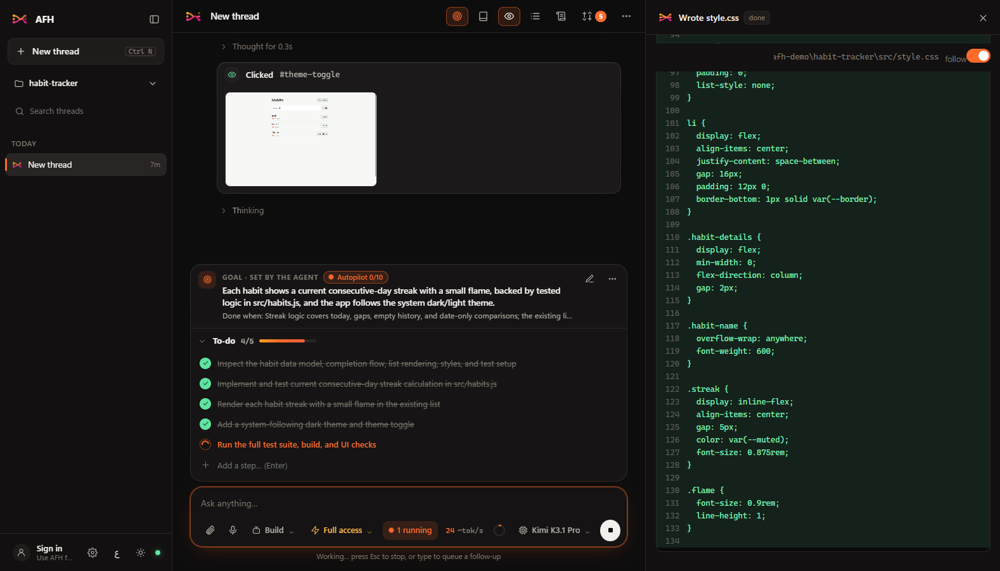
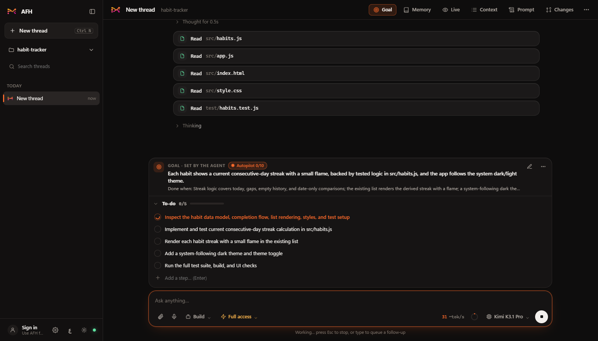
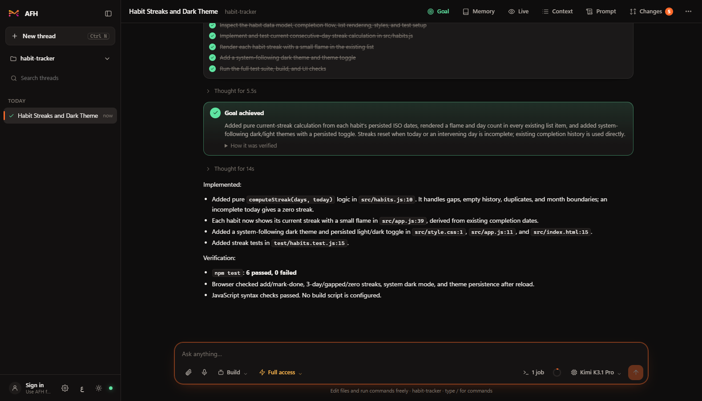
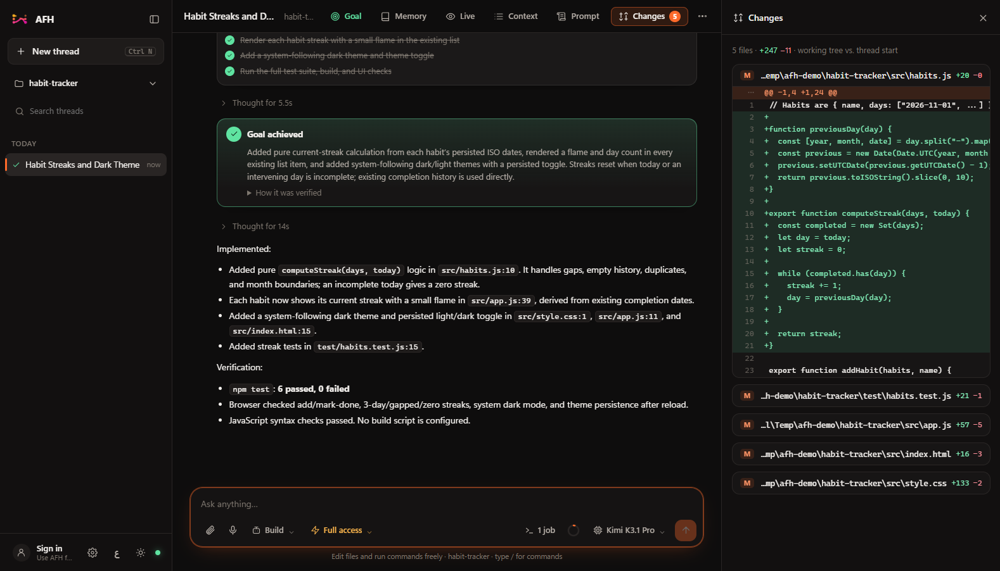
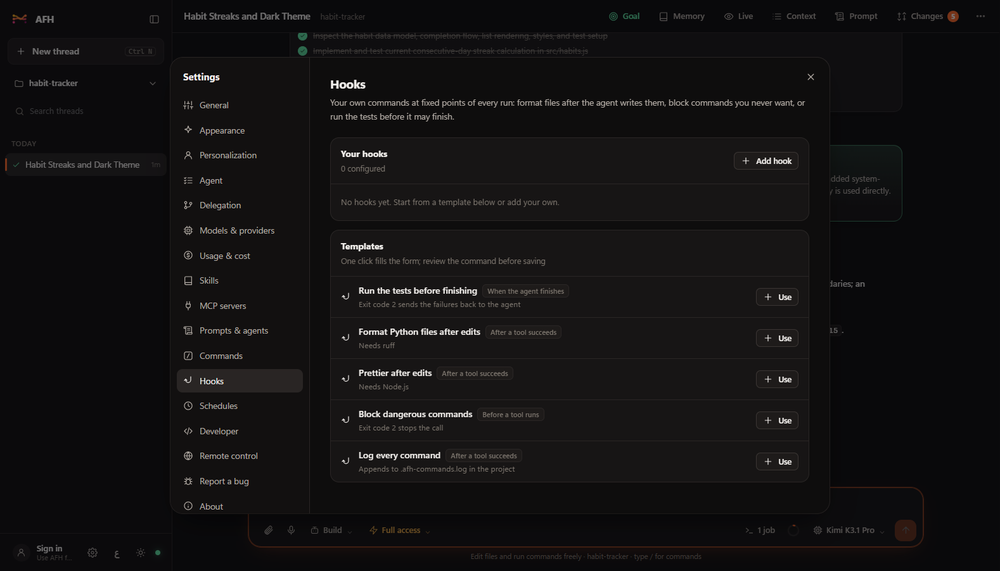
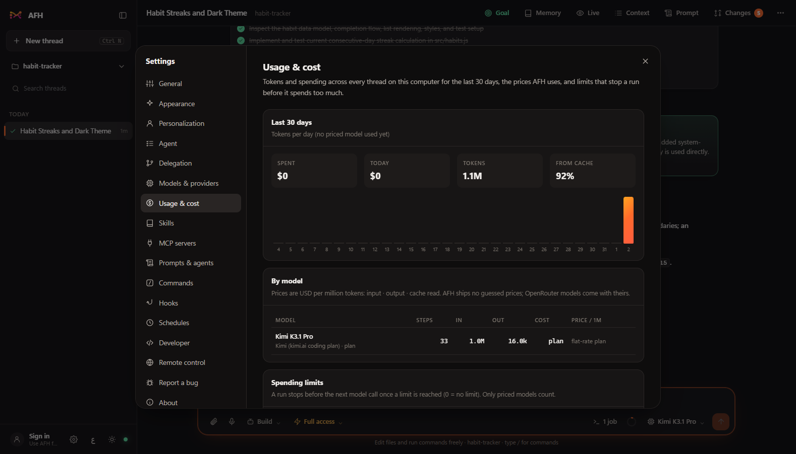
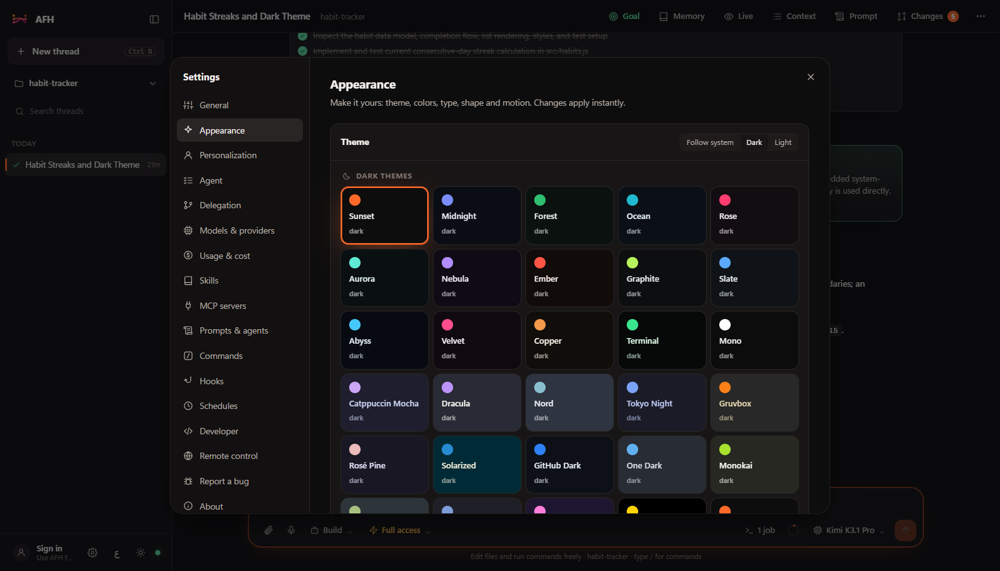
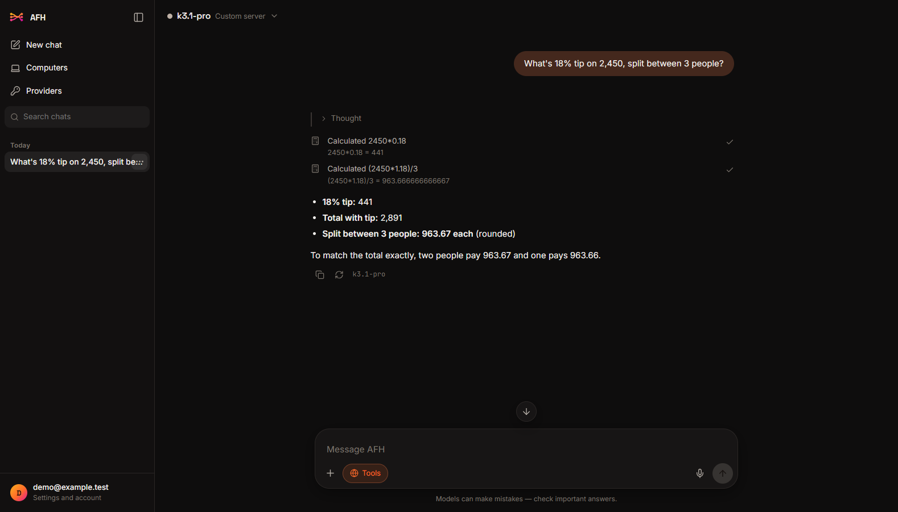
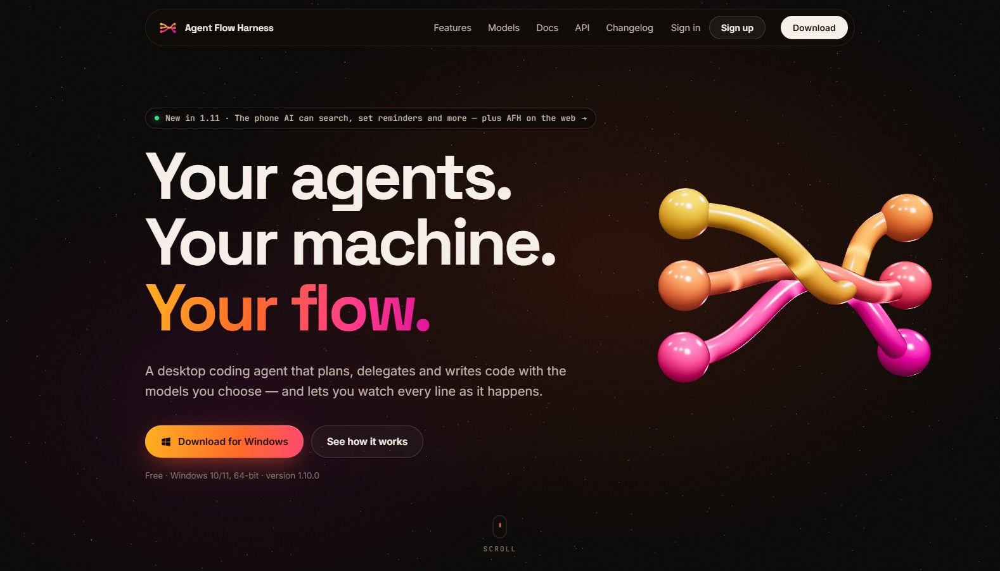

<p align="center">
  <a href="https://agentflowharness.com"></a>
</p>

<h1 align="center">Agent Flow Harness</h1>

<p align="center">
  <b>Your agents. Your machine. Your flow.</b><br/>
  A free desktop coding agent for Windows that plans, delegates and writes code with the models you choose,<br/>
  and lets you watch every line as it happens. Plus an app for Android and iPhone, and AFH Chat on the web.
</p>

<p align="center">
  <a href="https://agentflowharness.com"><b>Website</b></a> ·
  <a href="https://agentflowharness.com/download"><b>Download</b></a> ·
  <a href="https://agentflowharness.com/features">Features</a> ·
  <a href="https://agentflowharness.com/models">Models</a> ·
  <a href="https://agentflowharness.com/docs">Docs</a> ·
  <a href="https://agentflowharness.com/api">API</a> ·
  <a href="https://agentflowharness.com/changelog">Changelog</a> ·
  <a href="https://agentflowharness.com/chat">AFH Chat</a>
</p>

<p align="center">
  <a href="https://agentflowharness.com/download"></a>
  <a href="https://agentflowharness.com/download"></a>
  <a href="https://agentflowharness.com/download"></a>
  <a href="https://agentflowharness.com/models"></a>
  
</p>

<p align="center">
  
</p>

---

## Contents

- [Why AFH](#why-afh)
- [Get it](#get-it)
- [A tour](#a-tour)
- [Everything it does](#everything-it-does)
- [AFH on your phone and on the web](#afh-on-your-phone-and-on-the-web)
- [Models and providers](#models-and-providers)
- [Everyday use](#everyday-use)
- [Build on it: API and SDKs](#build-on-it-api-and-sdks)
- [Private by design](#private-by-design)
- [For developers](#for-developers)
- [License](#license)

## Why AFH

- **It finishes the job.** Give it a task and it sets a goal, plans it as a to-do list you can edit, does the work, runs the tests, checks the result in a real browser and tells you the goal is achieved, or exactly what is in the way.
- **You see everything.** Code streams into the Live pane character by character. Every thought, tool call, command and diff is in the thread, and the Context view shows exactly what the model sees.
- **Any model, mixed freely.** 228 providers, local models, or sign in with the ChatGPT, GitHub Copilot or OpenRouter plan you already pay for. Lead with a strong model and hand work to fast, cheap ones.
- **You stay in control.** Ask first, Full access or Read only. Stop is instant. Undo rewinds the thread *and the files on disk*.
- **It's yours.** Everything runs and is stored on your PC. No account needed, and the app sends no telemetry. The engine is written from scratch in this repo, in plain Python.

## Get it

| | |
|---|---|
| **Windows** | Download the installer from **[agentflowharness.com/download](https://agentflowharness.com/download)** (or [Releases](../../releases)) and run it. Windows may show *"Windows protected your PC"* because the app isn't code-signed yet: click **More info → Run anyway**. AFH updates itself after that. |
| **Android** | Download the APK from the [download page](https://agentflowharness.com/download) and open it (allow installs from your browser when asked). |
| **iPhone** | Download the IPA from the [download page](https://agentflowharness.com/download) and install it with [Sideloadly](https://sideloadly.io) or [AltStore](https://altstore.io). |
| **Web** | Open **[agentflowharness.com/chat](https://agentflowharness.com/chat)** and sign in. Nothing to install. |

**First run on Windows:** AFH opens *Models & providers*. Sign in with ChatGPT, GitHub Copilot or OpenRouter, paste an API key, or pick a local model (Ollama, LM Studio and friends need no key). Then open a project folder and ask for something.

Your settings, keys and threads live in `C:\Users\<you>\.afh` and never leave your PC, except to the model providers you choose.

## A tour

<table>
<tr>
<td width="50%"><br/><b>It plans its own work.</b> The agent turns your request into a goal with a clear "done when", and a to-do list you can tick, add to, reorder or edit while it works.</td>
<td width="50%"><br/><b>It checks before it says "done".</b> Tests run, the page is clicked through in a real browser, and the goal is marked achieved with how it was verified.</td>
</tr>
<tr>
<td width="50%"><br/><b>Every change, reviewable.</b> The Changes pane lists every file the thread touched, with diffs. Undo to any message rewinds the files too.</td>
<td width="50%"><br/><b>Bring any model.</b> Sign in with a plan you already pay for, paste a key, or point it at any compatible endpoint.</td>
</tr>
<tr>
<td width="50%"><br/><b>Models working together.</b> In Delegate mode one model leads and hands tasks to delegates, each with its own model and job.</td>
<td width="50%"><br/><b>Extend it in one click.</b> Install skills from the skills.sh store, add MCP servers, or just ask: the agent installs new abilities itself.</td>
</tr>
<tr>
<td width="50%"><br/><b>Hooks.</b> Your own commands before or after any tool, or when the agent stops: format on save, block risky commands, "the tests must pass".</td>
<td width="50%"><br/><b>Know what it costs.</b> Tokens, cache hits and cost per thread, 30 days of usage, your own prices and spending limits.</td>
</tr>
</table>

## Everything it does

**Plans and finishes**
- **Goals:** for any multi-step task the agent sets a goal and works until it's met, or reports *blocked* with what it needs. Set one yourself with `/goal`. With **autopilot** it keeps going on its own.
- **A to-do list you can touch:** every step shows above the message box; your edits reach the agent on its next turn.
- **It asks instead of guessing:** when a choice is really yours, it pauses with multiple-choice questions.
- **Project memory:** how to run and test the project, the gotcha that cost an hour, the way you like things done. The agent saves what it learns, and every new thread starts knowing it. Say "remember…", type `/remember`, or edit it under **Memory**.
- **Picks up after a restart:** close the app mid-run, or lose power, and interrupted runs resume by themselves.

**Splits the work**
- **Three modes:** *Build* does the work, *Plan* investigates and proposes without changing anything, *Delegate* leads and hands tasks to your delegate models. Or create your own agents.
- **Helpers in parallel:** the built-in Helper (your own model) plus your own subagents run side by side; watch any of them live from the top bar.
- **Mix models:** lead with your strongest model, delegate tests to a fast one and styles to another, across providers.
- **Git worktrees:** give a thread or a delegate its own branch and folder, then merge it back with one click.

**You watch it work**
- **Live file pane:** tool arguments stream as they are generated, so code appears character by character.
- **Every step on a timeline:** thinking time, each tool call, tokens per second and how long each reply took.
- **It checks its work in a browser:** the browser tool drives a real Chrome or Edge, and screenshots go back to models that can see.
- **Errors caught after edits:** Python, JSON, TOML, JavaScript, TypeScript (your project's `tsc`), Go, PHP, Ruby and your own linters; problems go straight back to the model.
- **Images and voice:** paste or drop screenshots and files; press the mic and speak (with a Groq or OpenAI speech key).

**You stay in control**
- **Approval modes:** *Ask first* (approve every edit and command, with diffs), *Full access*, *Read only*. Reading `.env` files always asks.
- **Stop is instant:** the run, the model call and any running command stop the moment you press Stop or Esc.
- **Rewind anything:** *Undo to here* rewinds the thread and the files on disk to just before a message. Or fork the thread from any point.
- **See everything:** *Context* shows and lets you edit everything the model sees; *Prompt* shows the exact system prompt.
- **Cost you can see:** tokens and cost per thread, budgets that stop a run, prompt caching on by default for Anthropic. Subscription plans count as no cost.

**Built for long sessions**
- **Endless threads:** when a conversation fills the model's context, older parts are summarised in place. You can still read every message. Or type `/compact`.
- **Background jobs:** dev servers, watchers and long builds run in the background while the agent keeps working (`/jobs`).
- **Schedules:** run a prompt every few minutes, hourly, daily, on weekdays or weekly; each run is a new thread you can read.
- **Bring your threads:** import from OpenCode or Zadloop; export any thread as JSON or Markdown.

**Make it yours**
- **46 themes** (29 dark, 17 light) with your own accent color, or build your own.
- **English and Arabic**, with a full right-to-left layout, switchable live.
- **Slash commands:** `/goal` `/todo` `/memory` `/remember` `/compact` `/jobs` `/new` `/cost` `/review` `/fix-tests` `/explain` `/commit`, plus your own as Markdown files (`.claude/commands` works too).
- **MCP servers and skills:** local or remote MCP servers, skills from `~/.afh/skills` or the project. Skills made for other agents work as they are.
- **It extends itself:** ask for a new ability and it installs skills, MCP servers, commands, hooks or custom agents.

<p align="center">
  
</p>

## AFH on your phone and on the web

<p align="center">
  
</p>

The **AFH app for Android and iPhone** does two things:

- **Chat with any model, straight from your phone:** all 228 providers, or sign in with ChatGPT, GitHub Copilot or OpenRouter. Keys stay in the phone's secure storage and chats go straight to the provider; it works with your computer off and without an account.
- **An assistant that can use your phone:** it searches the web and reads pages, checks the weather and where you are, sets reminders, adds calendar events, finds contacts, drafts calls, texts and emails for you to send, opens maps and links, uses the clipboard, does math and remembers things you tell it. Each step shows in the reply.
- **Your computers, from anywhere:** sign in and see which computers are online, follow their threads live, approve and answer with a tap, send the next task, start a new thread or stop a run. Nothing to open on your router.

**AFH Chat** at [agentflowharness.com/chat](https://agentflowharness.com/chat) is the same chat in your browser: the same providers, sign-ins and tools, with your chats kept in your browser. **Computers** follows AFH on your PCs live.

<p align="center">
  
</p>

The optional **AFH account** is only for reaching your computers and the web chat. AFH itself needs none, and the server never stores your threads, files or keys.

## Models and providers

- **228 providers** from the open models.dev catalog: OpenAI, Anthropic, Google Gemini, Kimi, Z.AI, DeepSeek, Groq, OpenRouter, Mistral, xAI, Together, Fireworks, Cerebras, Perplexity and many more. Context windows, effort levels, inputs (image, video, audio, PDF) and prices come from the catalog, and you can correct them by hand.
- **Sign in instead of pasting a key:** ChatGPT (Plus, Pro or Team), GitHub Copilot (Claude, GPT and Gemini through your Copilot plan) and OpenRouter.
- **Local models with no key:** Ollama, LM Studio, vLLM, llama.cpp and Jan. AFH finds the ones running on your computer.
- **Any compatible endpoint:** anything that speaks the OpenAI, Anthropic or Gemini API.
- Hide the models you don't use so the picker stays short.

See the full list at [agentflowharness.com/models](https://agentflowharness.com/models).

## Everyday use

| Where | What |
|---|---|
| **Mode** (message box) | *Build*, *Plan*, *Delegate*, or your own agents. |
| **Approval** | *Ask first*, *Full access* or *Read only*, per thread, changeable any time. |
| **Model** | Model and effort level for this thread. |
| **Goal** and **Memory** | What done looks like, autopilot and the live to-do list; what the agent knows about the project. |
| **Worktree** (new thread, git projects) | The thread works on its own branch; the branch chip merges it back. |
| **Live**, **Context**, **Prompt**, **Changes** | Watch files being written; see and edit what the model sees; the exact system prompt; every file changed, with diffs. |
| **Type `/`** | Commands. |
| **Hover a message of yours** | **Undo to here** rewinds the thread and your files. |

Keyboard: `Enter` send · `Shift+Enter` new line · `/` commands · `Ctrl+P` command palette · `Esc` stop · `Ctrl+N` new thread · `Ctrl+K` search · `Ctrl+B` sidebar · `Ctrl+,` settings.

## Build on it: API and SDKs

Everything the app does is a local REST API: create threads, send messages, stream every token and tool call, read replies and diffs, set goals and approve actions. Use one key from **Settings → Developer**.

```python
from afh_sdk import AFH            # sdk/python: one file, standard library only

afh = AFH()                        # finds the running app; key from $AFH_API_KEY
result = afh.run("Add a /health endpoint and a test for it", directory=r"C:\code\api")
print(result["reply"])

for event in afh.events():         # live events from every thread
    print(event["type"])
```

The JavaScript SDK is `sdk/js/afh.mjs`. Full reference: [agentflowharness.com/api](https://agentflowharness.com/api).

## Private by design

- Threads, settings and undo history live in `~/.afh` on your PC.
- API keys are stored only on your computer (or in your phone's secure storage).
- Your code goes only to the model providers you choose.
- The only other calls: the update check, the model catalog refresh, and web search or voice if you turn them on.
- The website's server log counts downloads, visits and apps in use (from update checks and phone sign-ins) as daily totals. Your code and chats are never part of that.

## For developers

```
afh/            Python backend (FastAPI + SSE), token-protected, loopback only
  api.py          the HTTP API the UI, the phone and the SDKs talk to
  cloud.py        the outgoing connection to the relay (remote control through an AFH account)
  store.py, transfer.py, skills_store.py, remote.py, devapi.py
afh/engine/     the AFH Engine
  core.py         providers, sessions, runs, undo, compaction, titles, delegation, goals, to-dos, cost
  runner.py       the agent loop: stream → tools (parallel when safe) → hooks → error checks → repeat
  providers/      OpenAI-compatible, Anthropic and Gemini adapters + the 228-provider catalog
  tools/          read, write, edit, patch, glob, grep, list, shell, webfetch, websearch, browser
  state.py, jobs.py, diagnostics.py, hooks.py, worktree.py, commands.py, schedules.py, memory.py,
  permissions.py, sessions.py, prompt.py, agents.py, mcp.py, skills.py, pricing.py, voice.py, auth.py
web/            the desktop UI: plain HTML/CSS/JS, no build step
desktop/        Electron shell + electron-builder (NSIS installer, auto-update)
app/            the phone app (Flutter): chats, tools, providers, remote control
relay/          the AFH account server (FastAPI): sign-in, computers, the relay, AFH Chat's forwarder
website/        agentflowharness.com, including AFH Chat (website/js/chat)
sdk/            Python and JavaScript SDKs
scripts/        build, install and deploy scripts
tests/          pytest (about 220 tests: engine, tools, providers, MCP, skills, relay, transfer)
```

```bash
# run from source
python -m venv .venv && .venv\Scripts\pip install -r requirements.txt
.venv\Scripts\python run.py --browser        # backend + UI in your browser
cd desktop && npm install && npm run dev     # or the Electron window

# test
.venv\Scripts\python -m pytest tests

# build the Windows installer
powershell -ExecutionPolicy Bypass -File scripts\build-backend.ps1   # PyInstaller → desktop/backend-dist
cd desktop && npm run dist                                           # → desktop/dist/AFH-Setup-<version>.exe

# build the phone app (Flutter 3.47)
cd app && flutter build apk --release
```

More in [docs/architecture.md](docs/architecture.md) and [CONTRIBUTING.md](CONTRIBUTING.md).

## License

MIT. Bundles marked (MIT), DOMPurify (Apache-2.0/MPL-2.0), highlight.js (BSD-3), Electron (MIT), FastAPI (MIT), httpx (BSD-3), the MCP Python SDK (MIT) and Flutter (BSD-3).

<p align="center"><a href="https://agentflowharness.com"></a></p>
