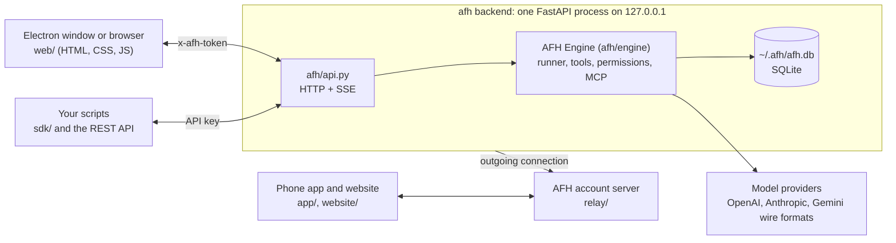

# How AFH works

## Processes

- **Electron** (`desktop/main.js`) starts the backend (`afh-backend.exe --headless` when installed, `python run.py --headless` in dev), reads the one line it prints (`AFH is running at http://127.0.0.1:<port>/#token=…`), opens that URL in a window and kills the backend tree on quit.
- **Backend** (`run.py` → `afh/api.py`) serves the UI and a JSON API. Every `/api/*` call needs the per-launch token (passed once in the URL hash, then kept in `sessionStorage`). It refuses other `Host` headers, so a web page can't reach it through DNS rebinding.
- **Engine** (`afh/engine/core.py`) runs in the same process on the server's event loop. There is no child engine process; MCP servers are the only subprocesses.

## The engine

- **Providers** (`afh/engine/providers/`). Three wire adapters, each an async generator of small events (`text.delta`, `reasoning.delta`, `tool.start`, `tool.delta`, `tool.end`, `usage`, `finish`, `error`): OpenAI-compatible chat completions (also Kimi, Z.AI, DeepSeek, Groq, OpenRouter, Ollama…), Anthropic Messages, and Gemini. `catalog.py` holds the one-click provider list, static model metadata and heuristics for unknown ids. Configured providers live in `~/.afh/providers.json` (`afh/engine/config.py`).
- **Runner** (`afh/engine/runner.py`). One `Run` per prompt: build the request from the stored messages, stream the model, translate provider events into the UI events the web app listens to (`session.text.delta`, `session.tool.input.delta`, …), store the assistant message as it grows, execute tool calls, loop until the model answers without tools. Retries 429/5xx with `session.retry.scheduled`; interrupt is an `asyncio.Event`. Per step it also: checks the spending limits, shortens old tool outputs when the prompt passes ~55% of the window (only what is sent; stored messages stay whole), runs consecutive read-only calls and delegations **in parallel**, runs the user's `pre_tool` / `post_tool` **hooks**, runs the **error checks** on the files the step changed (`diagnostics.py`) and appends problems to the last edit's result, and records the step's **cost** (`pricing.py`).
- **Stopping** (`Engine.on_agent_stop`). When the model ends its turn, three things may send it back to work, each as a stored `synthetic` message the UI shows as a notice: a `stop` hook exiting 2 (at most 3 times per run), **goal autopilot** (the goal is still active; at most `maxTurns` per user message), and, once per run, an out-of-date to-do list.
- **Tools** (`afh/engine/tools/`). `read`, `write`, `edit`, `patch`, `glob`, `grep`, `list`, `shell` (with `background: true` for servers and watchers), `webfetch`, `websearch` (when a search key is set), plus `jobs` (background jobs, `jobs.py`), `todo` and `goal` (`state.py`), the `skill` tool and every tool from connected MCP servers. Each tool computes its result first, then asks the permission gate, then records an undo snapshot, then writes.
- **Permissions** (`afh/engine/permissions.py`). A thread holds rules `{action, resource, effect}`; the last match wins. Modes are rule presets: *Full access*, *Ask first* (edits and commands ask), *Read only* (edits and commands denied). Asking publishes `permission.asked`, the UI answers `once` / `always` / `reject`; `always` appends an allow rule to that thread.
- **Prompt** (`afh/engine/prompt.py`). The harness prompt (editable in Settings → Prompts) + mode rules + `AGENTS.md` files (global, legacy OpenCode, project) + personalization + the skills catalog + MCP server instructions + an environment block. The Prompt drawer shows the exact assembled text.
- **Sessions** (`afh/engine/sessions.py`). SQLite in `~/.afh/afh.db`: sessions, messages (JSON, in order) and snapshots (a file's bytes before a tool changed it). A session's `metadata.afh` holds its approval mode, **to-do list**, **goal** and **worktree**; `project` ties a worktree thread to the project it came from.
- **Prompt caching**. The Anthropic adapter marks the tools, the system prompt and the newest two user turns with `cache_control`; OpenAI-compatible providers and Gemini cache on their own. Usage is normalised so `input` is always the uncached part, with cache reads and writes counted separately.

## Goals and the to-do list

The `todo` tool replaces the thread's list on every call (the user can edit it from the dock; the model is told with a hidden system message). A goal (`/goal`, the Goal button, or `PUT /api/sessions/{id}/goal`) adds a "Goal of this thread" section to the system prompt and the `goal` tool, which the model calls with `achieved` (refused while to-do items are open), `blocked` or `progress`. Autopilot continues the run while the goal is active, with a fresh budget whenever the user replies.

## Worktrees

`afh/engine/worktree.py` runs `git worktree add -b afh/<slug> ~/.afh/worktrees/<repo>-<id>`. A worktree thread's directory is that folder; its branch is merged back (`git merge --no-ff`, aborted on conflicts) or removed from the top-bar chip. `subagent` with `worktree: true` gives a delegate its own worktree, so parallel delegates never write to the same files. Deleting a thread removes its worktree unless it holds uncommitted or unmerged work.

## Delegate mode

Delegates are agents defined in Settings → Delegation. The leader (`delegate` mode) gets the harness prompt plus delegation rules and the list of delegates, and a `subagent` tool. Calling it creates a **child session** (`parentID` = the thread) that runs the delegate's own model and system prompt with the same permission rules; the leader waits for it (or continues in the background and receives the report as a message). `web/js/delegate.js` links each `subagent` tool call to its child session, shows live stats and pending approvals in the card, and mounts a second `ChatView` on the child for the Watch pane.

## Context editing and undo

- **Undo** rewinds the thread to just before a message and restores every file touched after it from the snapshots. The removed messages and the current file contents are stashed, so *Put it back* (`revert/clear`) restores both; *Keep* (`revert/commit`) drops the stash.
- **Context edit** replaces the thread's messages in place; the session keeps its id.
- **Compaction** runs before every step when the conversation (measured by size, so an imported thread of millions of tokens counts) would use about 80% of the model's context, or on `/compact`. A history too long for one call is cut into chunks that are summarised three at a time and merged. If even that is not enough, the oldest messages are left out of the request (never out of the thread) with a note to the model.
- Compaction details: older messages (tool calls included) are summarised into a `compaction` message that also carries the to-do list and the goal, and the last few are kept. An empty summary never replaces the history.

## Session transfer and migration

`afh/transfer.py` exports `{format: "afh-session", info, messages}` and imports AFH files, raw OpenCode exports, and Zadloop/DeepSeek Harness logs (`~/.dsh/sessions/**/session.v4.jsonl.zstd`, converted to AFH messages with tool calls paired to their results). `afh/engine/migrate.py` reads an OpenCode install read-only (its SQLite database and `opencode.json`) and copies API keys, custom endpoints, MCP servers and threads into AFH.

## The Workbench and the browser

The Workbench is the panel on the right of a thread: Live, Changes, Browser, Context, Prompt and Agents as tabs (`web/js/main.js`, `web/js/livefile.js`, `web/js/browser.js`). Live follows the streamed arguments of `write` and `edit` calls and the output of running commands.

The `browser` tool (`afh/engine/tools/browser.py`) drives a real browser over the DevTools protocol. In the desktop app the page runs in the built-in side panel, where the user can watch or take over, and each thread has its own tab. Outside the app it uses Chrome or Edge with its own profile. Screenshots go back to models that accept images.

## Computer use

The `computer` tool (`afh/engine/tools/computer.py`) is for work with no file, command or web route. It's only offered on Windows. It asks before it uses an app, once for everything a task needs, and a thin frame around the screen shows while it's working.

## Design first

Before building a new app, site or set of screens, the agent can show 2 to 4 design options as live screens in device frames (`afh/engine/design.py`, `web/js/design.js`). The user picks one and the agent builds from it.

## Red Team mode

`redteam` is a primary agent with the same no-edit permissions as Plan and its own rules (`store.REDTEAM_RULES`). It audits the user's own project and reports what it finds. It stays in scope and never changes the code.

## Accounts and the relay

The optional AFH account lives in `relay/app.py`. `afh/cloud.py` keeps one outgoing connection from the computer to the relay, so nothing has to be opened on a router. The phone app and the website reach a computer through `/r/<computer>/…`. The server passes those requests on and stores no threads, files or keys.

## Remote control

`afh/remote.py` starts a second uvicorn listener on `0.0.0.0:<port>` on the same event loop, serving the same app. Requests arriving on that listener are only accepted with a token issued by `POST /api/remote/login` (PBKDF2-hashed password, rate-limited). An optional Cloudflare quick tunnel (`cloudflared tunnel --url …`) exposes it outside the network; its URL and a QR code are shown in Settings.
